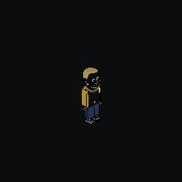

# Tweebbo for Nintendo Switch (showcase proof of concept)

Native Nintendo Switch client of [Tweebbo](https://tweebbo.lol) (C11 + libnx + SDL2 + mbedTLS).
It plays **in the same hotel as the web, the 3DS and the Vita**: the same rooms, characters,
credits and chat. This is a **showcase proof of concept**: the room, the avatars, the classic
interface and the cross-play badges, with the five brand models rotating over your character.
It is the base to grow the full port (see `../Tweebbo-designs/PORTS-SHOWCASE-2026-10.md`).



## What it does

- **Local hotel only**: this proof of concept never talks to `tweebbo.lol`. It plays on the hotel
  of the Wi-Fi it was built for: `./build.sh` bakes in `ws://<this PC's LAN IP>:8096` (or
  `TWEEBBO_SERVER`), and only private LAN `ws://` addresses are accepted (a `server.txt` with
  anything else is ignored). Protocol v6 with the same reconnection as the 3DS client; `HELLO`
  carries `platform = 1` plus the trailing device byte `2` (Switch).
- **Room**: isometric rendering at integer zoom (1× by default, the whole room; 2× with R), room background or
  layered public room, furniture with its own textures (LRU cache), avatars composed with the
  shared compositor, chat bubbles and the classic bottom bar.
- **Showcase**: the five brand models (Bobba, Cyber, Director, Street, VIP Girl) rotate every
  ~5 s with `SET_LOOK`, the character waves/dances and walks a little, and a banner names the
  model. Every console and the web see the same character change.
- **Cross-play**: the server announces each native device (`s2c DEVICE`); the pixel-art badge of
  the 3DS, the Switch and the Vita floats over the players.
- **Offline in the same build**: when the hotel does not answer, the connection screen offers
  **Minus - play offline** (also a tap on it): the local simulation with bots in the lobby, where the
  models keep rotating. Minus again goes back to the hotel. Every launch tries the hotel first.

## Controls

| Control | Action |
| --- | --- |
| Left stick / D-pad | Walk |
| A | Contextual: sit on a nearby seat or use furniture; otherwise wave |
| X | Wave |
| Y | Quick chat ("Hello from Nintendo Switch!") |
| B | Next showcase model |
| L / R | Zoom 1× (whole room, default) / 2× (close-up) |
| Minus (Select) | Play offline / back to the hotel |
| Plus (Start) | Quit (HOME also works) |
| Touch | Walk to the tapped tile |

## Building

The Switch toolchain is not needed on the host: everything builds inside the official
`devkitpro/devkita64` container (SDL2, SDL2_image and mbedTLS come from its portlibs).

```bash
tools/fetch-assets.sh      # copies the shared graphics from a Tweebbo-3DS build tree
./build.sh                 # podman/docker: out/tweebbo.nro
./build.sh clean
```

Install: copy `out/tweebbo.nro` to `sdmc:/switch/Tweebbo/tweebbo.nro` and launch it from the
Homebrew Menu (Atmosphère). Settings live in `sdmc:/switch/Tweebbo/` (`server.txt`, `room.txt`,
`token-<server>.txt` — **private** — and `log.txt`).

The hotel is the showcase hotel of this PC (`~/Tweebbo-Showcase-2026-10-17/INSTALL.md`, port
8096). If the PC's address changes, rebuild, or point a console at the new one without rebuilding
(private LAN `ws://` addresses only):

```bash
printf 'ws://192.168.1.20:8096' > /path/to/sd/switch/Tweebbo/server.txt
```

## Layout

```
source/            shared C11 core (also compiled by the Vita client)
  proto.c world.c avatar.c ws.c net.c sim.c path.c catalog.c text.c show.c
  gen/             generated tables from tools/pack.py (assets.c, font.c)
  nx/              Nintendo Switch platform layer
    conn.c         libnx sockets + mbedTLS (SocketInitConfig tuned against ENOBUFS)
    gfx.c          SDL2 renderer (integer scale, nearest, LRU furniture cache)
    log.c          asynchronous log ring drained to the SD card
    main.c         SDL2 loop, PadState and touch input, SD storage
romfs/             PNG assets fetched from the 3DS export (gfx/ and furni/)
```

## Lessons applied (NX-torrent-player)

- Logs never touch the microSD from the render thread: a 256 KB ring in RAM is drained by a
  low-priority thread (microSD garbage collection can block a frame for ~1 s).
- `SocketInitConfig` keeps the per-socket TCP buffers compact so WebSocket + API requests never
  exhaust the shared BSD pool (`ENOBUFS`).
- Embedded CA roots (`source/certs.c`) because the console mounts no system store for mbedTLS,
  with mandatory certificate verification.
- Touch and pad are read in the same frame (no input-mode switch that swallows the first A).

## Not in this proof of concept

Build mode, catalogue, inventory, friends, pets, games, casino, Snow Storm, audio, in-game
updates and the NSP forwarder stay on the roadmap of the ports document.

## Desktop harness

There is no usable Switch emulator without console keys, so `tools/host/run.sh` compiles the
shipped sources (the shared core, `source/nx/gfx.c` and `source/nx/conn.c`) for Linux with a
keyboard main (`tools/host/main.c`) and runs them headless under Xvfb in a container, saving a
screenshot in `build/host/shot.png`:

```bash
SERVER=ws://127.0.0.1:8092 SHOT_MS=20000 tools/host/run.sh
```

Only the libnx calls (socket service, csrng, pad) differ from the console build.

